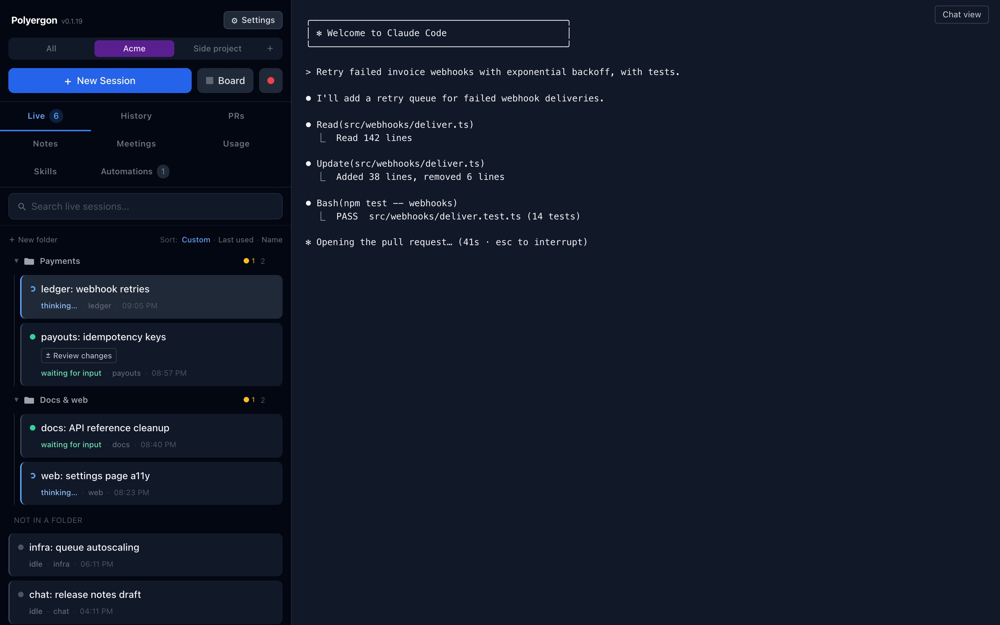
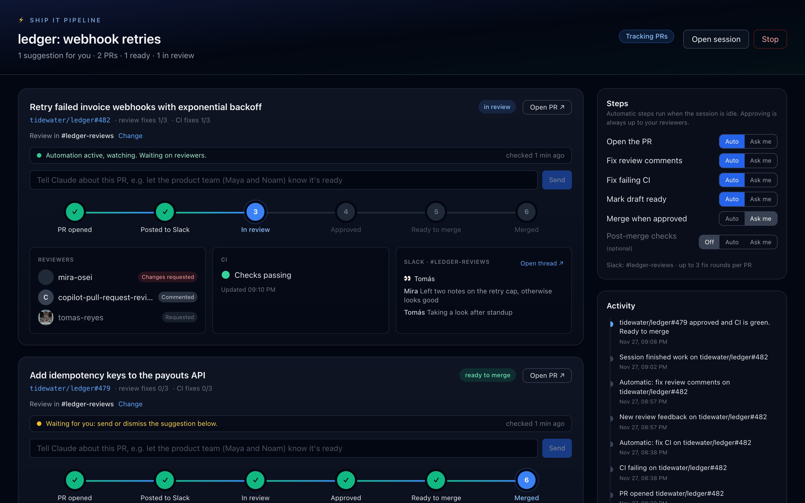
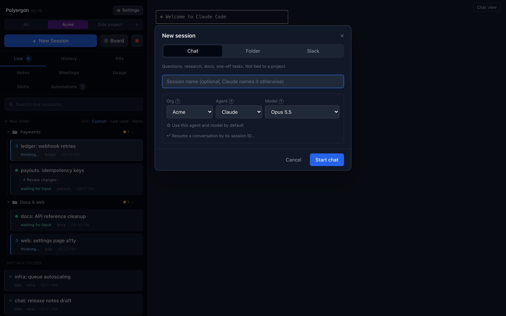

<p align="center"></p>

<h1 align="center">Polyergon</h1>

**Boost your velocity: run every Claude Code session from one screen.**

Polyergon is a local app for people who run many Claude Code (or GitHub Copilot CLI) sessions at once. It shows which sessions need you, ships their pull requests, keeps up with Slack, and records meetings. It runs on your machine, and it's open source under the MIT license.

[](https://github.com/polyergon/polyergon/actions/workflows/ci.yml) [](https://www.npmjs.com/package/polyergon)

[polyergon.ai](https://polyergon.ai) · [npm](https://www.npmjs.com/package/polyergon)






> **Status:** early (v0.1). Built and tested on macOS. Sessions should work on Linux but are untested. Windows is not supported.

## What it does

**[See everything it does](docs/features.md)** · **[Examples](docs/examples.md)** · **[Guides](docs/README.md)**

### Sessions
- Real Claude Code and Copilot terminals in the browser, side by side. Each card shows **thinking**, **waiting for you** or **idle**, cost, and how close it is to compacting.
- **New session** from a plain chat, any folder (search or **Browse…**), or a **Slack channel, thread or DM** as context. Optionally on its **own git worktree**.

  

- **Chat view:** read a session as chat, with right-to-left text shown properly and Claude's questions as buttons.
- **Review changes** with line comments, a **task board** that turns tasks into sessions, auto-continue after usage limits, stall alerts, <kbd>⌘K</kbd> search.

### Ship it: PRs that move on their own
Open the PR → ask for review → fix review comments → fix CI → merge → optional **post-merge checks**. Each step is **Auto** or **Ask me**.
- Every PR the session opens shows up in about 15 seconds, each with its **own review setup**: Slack channel, **DMs** to people you pick, GitHub reviewers.
- Drafts wait until they're marked ready. "Ready to merge" means approved, green, no open threads, and your chosen reviewers done.
- A live status per PR (working now, queued, waiting for you, watching), and a **Tell Claude** box ("let product know it's ready").

### Slack
- **Inbox:** mentions and DMs waiting on you, with suggested replies.
- **Channel watcher:** drafts replies from a session's knowledge, or answers on its own. Requests that need real work go to the session, which finishes and verifies them (asking you before production changes) and replies in the thread.

### Meetings (beta, macOS)
Live transcript (**free, offline local Whisper**, or OpenAI/Azure, any language), running notes, Q&A and a summary you can send to Slack.

### More
Separate **orgs** (Claude login or API key, Slack, skills per org), skills and plugins, your PRs, usage and cost, notes with reminders, a Home dashboard, and **install as an app** with its own notifications.

## Requirements

- macOS, Node.js 20 or newer
- [Claude Code](https://docs.claude.com/en/docs/claude-code) installed and logged in, and/or GitHub Copilot CLI
- Optional: [`gh`](https://cli.github.com) for PRs and Ship it
- Optional, Slack features: the Slack connector or plugin in Claude Code
- Optional, meetings: `ffmpeg`, [BlackHole](https://github.com/ExistentialAudio/BlackHole), and transcription: free and offline with Whisper (`brew install whisper-cpp`; the app downloads the model), or an OpenAI or Azure OpenAI key

## Install

On a Mac, **[download the installer](https://polyergon.ai/download/Polyergon-Installer.zip)** (unzip, double-click; the first time, allow it in System Settings → Privacy & Security → Open Anyway), or run the same installer in Terminal. It sets up Node if needed, starts Polyergon at login, and opens it:

```bash
curl -fsSL https://polyergon.ai/install.sh | bash
```

Run it again to update. Or, with Node 20+:

```bash
npx polyergon
```

Or install it once and run `polyergon`:

```bash
npm install -g polyergon
polyergon
```

From source:

```bash
git clone https://github.com/polyergon/polyergon.git
cd polyergon
npm ci && npm run build
npm start
```

Polyergon opens in its own window, with no tabs or address bar, at `http://polyergon.localhost:3030`. To keep it in the Dock, open **Settings → App → Install Polyergon**.

Most options are set in the app under **Settings**: Claude sign-in or API key, auto-compact, permission prompts, keeping the Mac awake, notifications and the transcription key.

### Environment variables

| Variable | Default | Purpose |
|---|---|---|
| `PORT` | `3030` | Port to listen on |
| `POLYERGON_DATA_DIR` | `~/.claude-session-manager` | Where sessions, notes, meetings, automations and settings are stored |
| `POLYERGON_NO_OPEN` | unset | Set to `1` to not open a window on start |
| `POLYERGON_WINDOW` | unset | Set to `browser` to open a normal browser tab instead of the app window |
| `POLYERGON_ALLOWED_HOSTS` | unset | Extra host names allowed to reach the app (comma-separated) |

## Report a bug

In the app: **Settings → Help → Report a bug** opens a GitHub issue with your versions filled in. Or [open one here](https://github.com/polyergon/polyergon/issues/new?template=bug_report.yml). Logs are in `~/Library/Logs/Polyergon.log` (Mac installer). Ideas go in [Suggest a feature](https://github.com/polyergon/polyergon/issues/new?template=feature_request.yml).

## Security

Polyergon drives real shells, so it is built to be reachable only by you.

- It listens on `127.0.0.1` only, and rejects requests from other websites (Host and Origin checks).
- API keys are stored on your machine in a file only your user can read, and never sent to the browser.
- Sessions ask before running commands or editing files, as Claude Code and Copilot normally do. **Settings → Skip permission prompts** turns that off. Only use it with folders you trust.
- **Automations type into your sessions** when a step is set to Auto (Ship it), and a channel watcher set to answer automatically **posts to Slack as you**. Set steps to Ask me if you want to approve each one.
- Background helpers (meeting assistant, Slack drafts, watchers) run headless with permission prompts off, so they can read links and connector content you give them. Content you add (links, meeting audio, Slack messages) becomes their input, so only add sources you trust.
- No telemetry or analytics. Polyergon talks only to the services you connect (such as Anthropic, GitHub, Slack, and OpenAI or Azure for meeting transcription), with your own credentials. The only network call it makes on its own behalf is the optional "Get updates" email signup: on first launch Home asks once (and Settings → Updates lets you subscribe later). Only if you enter an email and click Subscribe, your browser sends that email to `polyergon.ai`.

Report vulnerabilities to **security@polyergon.ai**. See [SECURITY.md](SECURITY.md).

## Development

```bash
npm run dev        # hot reload on http://localhost:3030
npm test           # unit tests
```

The app is a Next.js front end with a small Node server (`server.ts`) that owns the terminals (node-pty), automations and Slack helpers. Code lives in `src/app` (UI) and `src/lib` (server logic). Issues and pull requests are welcome; see [CONTRIBUTING.md](CONTRIBUTING.md).

## License

[MIT](LICENSE) © Ofir Yehoshua
